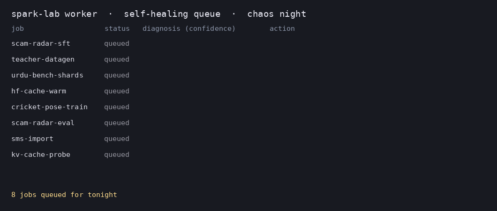
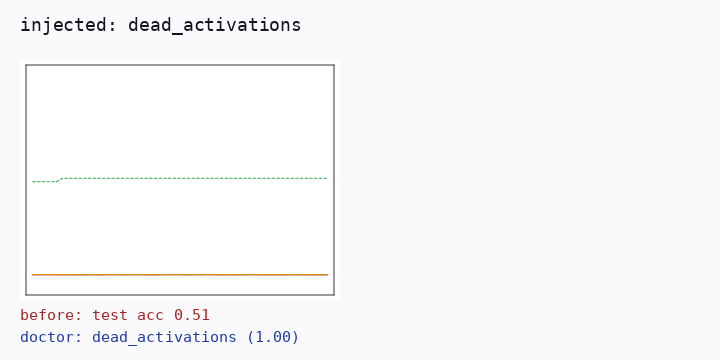
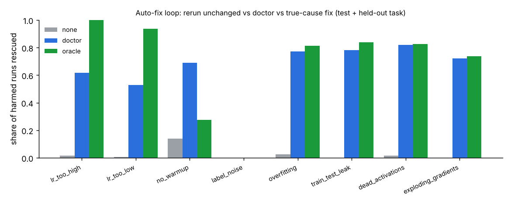

# spark-lab

The always-on job runner behind my AI projects. An NVIDIA DGX Spark generates data,
fine-tunes models and runs evals every night; coding agents write the code by day; a
report lands in `reports/` every morning.

```
pull requests ──► main ──► 23:00 nightly.sh ──► queue ──► worker ──► reports/<date>.md ──► phone alert
                                   ▲                 │
                         jobs/nightly.d/*.json       └─ checkpoints, retries, resume after power cuts
```

## What it does

- **File-based job queue** (`lab/queue.py`). Jobs are JSON files that move
  `queue/ → running/ → done/ | failed/` with atomic renames, so a crash or power cut never
  loses one. On restart, interrupted jobs go back to the front of the queue.
- **Resume, not restart.** Jobs with `resume_dir` get the newest `checkpoint-N/` passed
  as `LAB_RESUME_FROM` on every attempt, so a power cut costs one checkpoint interval.
- **Retries, timeouts, a single-worker lock, and a disk guard** that pauses the worker
  and alerts before the disk fills.
- **Phone alerts through ntfy** for job done, job failed (with the last log lines),
  disk nearly full, and the nightly summary.
- **Nightly report** (`lab/report.py`): jobs from the last 24 hours, results quoted from
  each job's own markdown report, failures, disk and GPU. Refuses to quote anything
  inside `eval/locked/`.
- **Self-healing.** When an attempt fails, `lab/triage.py` classifies the log tail (OOM,
  disk full, CUDA error, network, bad data, flaky, code bug) and `lab/heal.py` applies the
  known fix: halve the batch and resume from the checkpoint, prune old checkpoints under
  `runs/`, back off and retry, or stop and write an `incidents/<time>-<job>.md` for an agent
  (bad data, code bug) or for me (anything it is unsure about). Every decision lands in the
  job file, the log and the nightly report's **Self-healing** section.
- **systemd units** for the worker, the 23:00 nightly timer (catches up after a missed
  night), the vLLM teacher model and the failure-classifier server.

## Quickstart on the Spark

```bash
mkdir -p ~/lab && cd ~/lab
git clone git@github.com:JehanzebAli11/spark-lab.git && cd spark-lab
bash scripts/setup_spark.sh            # checks only; lists the sudo steps for you to run
bash scripts/setup_spark.sh --apply    # installs the user services
python3 -m lab notify "hello"          # test the phone alert
python3 -m lab enqueue jobs/nightly.d/example-smoke.json && python3 -m lab worker --once
```

Project repos sit next to this one (`~/lab/scam-radar`, …) and jobs reach them with
`"cwd": "../scam-radar"`. See `jobs/examples/` for a training job that resumes from checkpoints and an eval job whose markdown lands in the nightly report.

## Self-healing queue



| Failure | Fix | Budget |
| --- | --- | --- |
| `oom` | halve `batch_env` (and `LAB_BATCH_SCALE`), resume from checkpoint | 3 |
| `disk_full` | keep the newest 2 checkpoints per run under `runs/`, retry | 2 |
| `network` | wait 30 s, 60 s, 120 s, ..., retry | 4 |
| `cuda_error` | one cool-down retry from checkpoint, then incident | 1 |
| `flaky` | retry | 2 |
| `bad_data`, `code_bug` | stop at once, incident for an agent | 0 |
| `unknown` (no error line, or confidence below threshold) | plain `retries`, then incident for me | `retries` |

The classifier is TF-IDF + logistic regression trained on chaos-job logs and exported to
JSON, so the queue still needs only the standard library. `python3 -m lab classify LOG`
classifies a log by hand; `python3 -m lab serve-triage` serves it over HTTP and
`LAB_TRIAGE_URL` points other machines at it. Job fields: `heal` (default true),
`max_heals` (default 4), `batch_env` (env var holding the batch size).

Chaos jobs (`lab/chaos.py`, 75 fault variants, real where a CPU allows) generate the
labelled training logs; `python3 -m lab.chaos --fault oom.torch_cuda` runs one.

## Training-run doctor

`labml/doctor/` trains thousands of tiny numpy runs with known bad settings, diagnoses
them from their curves (a CNN on the picture, gradient boosting on curve and telemetry
features), and runs an auto-fix loop: diagnose, change the setting, rerun.





## Results

<!-- results:start (generated by python -m labml.readme) -->

### Failure classifier (chaos logs, CPU)

TF-IDF + logistic regression, confidence threshold 0.55. In-distribution = new seeds of known fault variants; unseen variants = fault phrasings never in training.

| Split | Rules acc | Model acc | Acts on (rest escalated) | Precision when acting |
| --- | --- | --- | --- | --- |
| in-distribution test | 0.605 | 1.000 | 100.0% | 1.000 |
| unseen variants | 0.714 | 0.683 | 50.5% | 0.717 |

On unseen variants the model is right 68% of the time without a threshold; with it, it acts on 50% and escalates the rest. The held-out split was looked at during development; see [`ITERATIONS.md`](results/log_classifier/ITERATIONS.md).

### Training-run doctor (tiny CPU runs)

| Doctor | Sees | Test acc | Held-out task family acc |
| --- | --- | --- | --- |
| image | curve picture (CNN) | 0.893 | 0.824 |
| curves | curve numbers (GBM) | 0.910 | 0.886 |
| features | curves + telemetry (GBM) | 0.984 | 0.969 |
| ensemble | image + features | 0.982 | 0.962 |

Auto-fix loop on harmed test + held-out-task runs (up to 3 rounds of diagnose, change setting, rerun):

| Policy | Rescued | Rate | Healthy runs hurt |
| --- | --- | --- | --- |
| rerun unchanged | 10/780 | 1.3% | 14/130 |
| features doctor | 458/780 | 58.7% | 3/130 |
| ensemble doctor | 459/780 | 58.9% | 3/130 |
| true-cause fix | 536/780 | 68.7% | 0/130 |

Details: [`results/log_classifier/report.md`](results/log_classifier/report.md), [`results/doctor/report.md`](results/doctor/report.md), [`results/doctor/autofix.md`](results/doctor/autofix.md). Datasets: [`datasets/chaos-logs`](datasets/chaos-logs/README.md), [`datasets/doctor-runs`](datasets/doctor-runs/README.md).

<!-- results:end -->

Reproduce (CPU, about 45 minutes on 4 cores):

```bash
pip install -e '.[ml]'
python -m labml.logs build && python -m labml.logs train
python -m labml.doctor.dataset && python -m labml.doctor.models && python -m labml.doctor.autofix
python -m labml.doctor.figures && python -m labml.demo queue && python -m labml.demo doctor
python -m labml.readme
```

## Job format

```json
{
  "name": "scam-radar-sft-v1",
  "cmd": ["python3", "-m", "scamradar", "train", "--config", "scamradar/train/configs/v1.yaml"],
  "cwd": "../scam-radar",
  "priority": 20,
  "timeout_min": 240,
  "retries": 2,
  "resume_dir": "runs/v1",
  "report": "runs/v1/eval.md"
}
```

Lower priority runs first. `report` is a markdown file the job writes; the nightly report
quotes it.

## Commands

| Command | Does |
| --- | --- |
| `python3 -m lab enqueue FILE...` | Validate and queue job files |
| `python3 -m lab worker [--once \| --drain] [--until HH:MM]` | Run jobs |
| `python3 -m lab status` | Queue, running job, disk, GPU |
| `python3 -m lab report [--date YYYY-MM-DD]` | Write `reports/<date>.md` |
| `python3 -m lab prune runs/ --keep 3 [--dry-run]` | Keep the newest checkpoints per run |
| `python3 -m lab notify "text"` | Test phone alerts |
| `python3 -m lab classify LOG` | Diagnose a failed job's log |
| `python3 -m lab serve-triage [--port 8040]` | Serve the failure classifier over HTTP |

## Ground rules

Training data comes only from open-weight models on the Spark or real consented data,
never from Claude, OpenAI or Gemini. `eval/locked/` is human-only. Uploads are private
until I publish them by hand with `publish/publish.sh`. Full rules for coding agents are
in [`CLAUDE.md`](CLAUDE.md) and [`AGENTS.md`](AGENTS.md).

## Development

```bash
pip install -e '.[dev]' && ruff check . && pytest -q
```

Standard library only at runtime (the queue, healer, classifier and chaos jobs), Python
3.10+. The `ml` extra (numpy, scikit-learn, matplotlib, Pillow, PyTorch) is only for
building datasets and training in `labml/`. MIT licensed.
